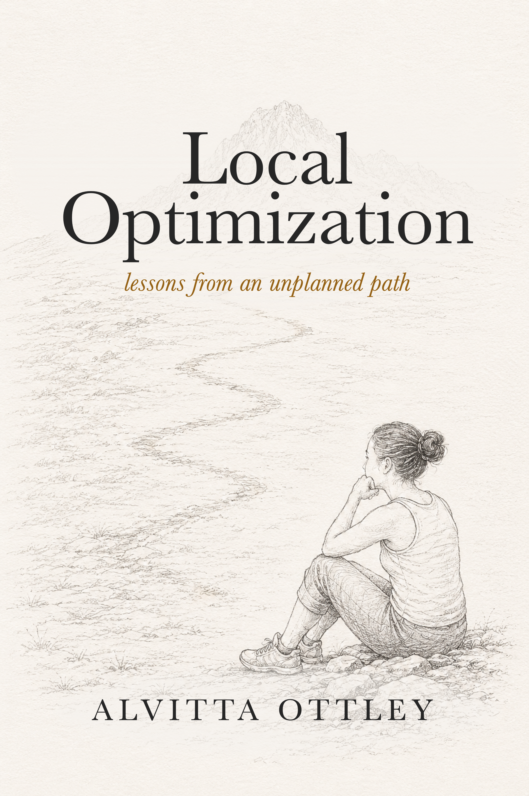
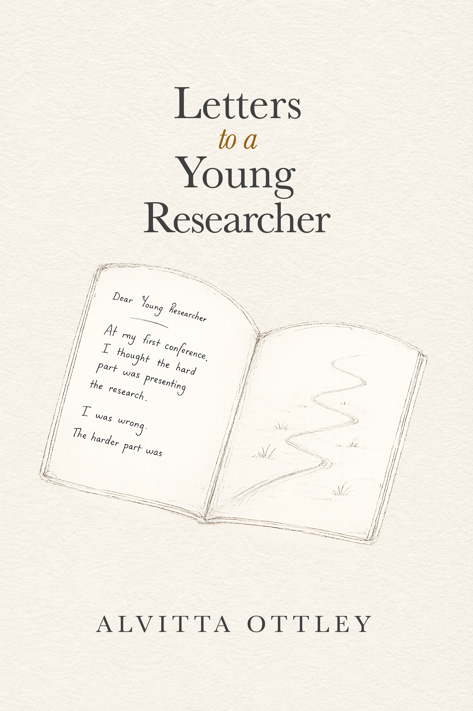

I am an Associate Professor in the Computer Science & Engineering Department at Washington University in St. Louis, Missouri, USA. I am also the director of the [Visual Interface and Behavior Exploration (VIBE)](https://visualdata.wustl.edu) Lab and hold a courtesy appointment in the Psychological and Brain Sciences Department.

My research uses interdisciplinary approaches to solve problems such as how best to display information for effective decision-making and how to design human-in-the-loop visual analytics interfaces that are more attuned to how people think.

I am deeply honored to have received the NSF CRII Award in 2018 for using visualization to support medical decision-making, the NSF Career Award in 2022 for creating context-aware visual analytics systems, and the 2022 EuroVis Early Career Award. My work has also appeared in leading conferences and journals such as CHI, VIS, and TVCG, where it has received the best paper and honorable mention awards.

Supervised by [Dr. Remco Chang](http://www.cs.tufts.edu/~remco/), I received my Master's and Ph.D. in Computer Science from Tufts University in 2013 and 2016, respectively. I completed my Bachelor's in Computer Science from the State University of New York at Plattsburgh in 2010.

## books

Alongside my research, I write about research culture, decision-making,
uncertainty, and academic life.

  

  

    <h4>Local Optimization</h4>
    
<em>What if success doesn't require a five-year plan?</em>

    

      A short reflective memoir about decision-making, uncertainty,
      and building a career through local optimization instead of attempting
      to predict the future.
    

    <a href="https://amzn.to/4gLk6fm">Available Here</a>
  

 

  

  

    <h4>Letters to a Young Researcher</h4>
    
<em> What does it really mean to become a researcher?</em>

    

      A collection of reflections on research, failure, writing,
      confidence, and navigating academia. It is the book I wish I hard as a student.
    

    <a href="https://amzn.to/4eSIbOR">Available Here</a>
  

 

<!-- 
## Books

Alongside my research, I write about research culture, decision-making, uncertainty, and academic life.

  

    

      
      

        <h4 class="card-title">Local Optimization</h4>
        
<em>What if success doesn't require a five-year plan?</em>

        
A short reflective memoir about decision-making, uncertainty, and building a career through local optimization.

        <a href="https://www.amazon.com/dp/B0H2393C24" class="btn btn-sm btn-outline-primary">Available Here</a>
      

    

  

  

    

      
      

        <h4 class="card-title">Letters to a Young Researcher</h4>
        
<em> What does it really mean to become a researcher?</em>

        
A collection of reflections on research, failure, writing, confidence, and navigating academia. It is the book I wish I hard as a student.

        <a href="https://www.amazon.com/dp/B0H2YNVDT6" class="btn btn-sm btn-outline-primary">Available Here</a>
      

    

  

  -->

<!-- Put your address / P.O. box / other info right below your picture. You can also disable any of these elements by editing `profile` property of the YAML header of your `_pages/about.md`. Edit `_bibliography/papers.bib` and Jekyll will render your [publications page](/al-folio/publications/) automatically.

Link to your social media connections, too. This theme is set up to use [Font Awesome icons](http://fortawesome.github.io/Font-Awesome/) and [Academicons](https://jpswalsh.github.io/academicons/), like the ones below. Add your Facebook, Twitter, LinkedIn, Google Scholar, or just disable all of them. -->
